# 2024 New Algorithm: Goose Algorithm Optimizes VMD Parameters, Five Different Fitness Functions Optionally Switched, Minimal Entropy, Sample Entropy, Information Entropy, Arrangement Entropy, Arrangement Entropy/Mutual Information Entropy

This issue employs the goose algorithm to optimize the VMD parameters. The MATLAB's built-in VMD function is utilized. After replacing the official VMD function, the optimization speed has significantly improved! If you have a large dataset, try this official VMD function. Of course, you need to download MATLAB 2020a or above to use it!
Taking the XiuYun University dataset as an example, select the data in X105_BA_time.mat with 1000 data points. For those without data, refer to this article. XiuYun University Bearing Diagnosis Data Processing, Free MATLAB Code Available  
Select five fitness functions for optimization to determine the optimal k and α parameters of VMD. The five fitness functions are: minimum entropic envelope, minimum sample entropy, minimum information entropy, minimum permutation entropy, permutation entropy/mutual information entropy. The code allows you to switch between them easily. As for which one to choose as your fitness function, you can refer to this article. Why does VMD need parameter optimization? Minimum entropic envelope/sample entropy/permutation entropy/information entropy, which fitness function should you choose?
1. Minimum entropic envelope as the fitness function
2. Minimum sample entropy as the fitness function
3. Minimum information entropy as the fitness function
4. Minimum permutation entropy as the fitness function
5. Composite indicator as the fitness function
Regarding the composite indicator, its introduction is as follows:
The indicator was derived from the literature: Lu Tie Ding, He Jin Liang, He Xiao Xing et al. Parameter optimization variational mode decomposition GNSS coordinate time series denoising method [J/OL]. Wuhan University Journal (Information Science Edition), 1-15 [2024-02-29]. https://doi.org/10.13203/j.whugis20220363.
Results graph:
Goose algorithm optimizes VMD parameters using five different fitness functions, switching between them freely, minimum entropic envelope, sample entropy, information entropy, permutation entropy, permutation entropy/mutual information entropy

## Images

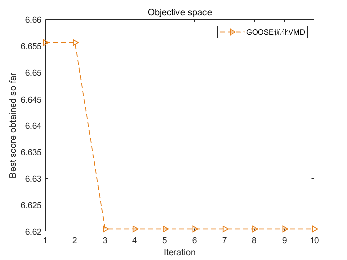
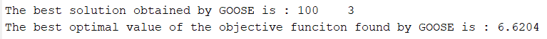
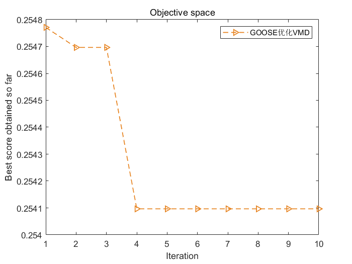
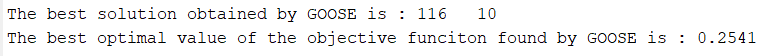
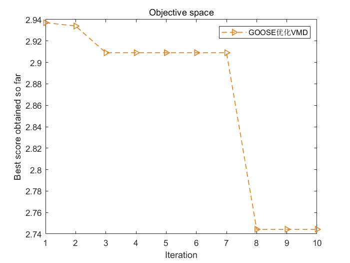
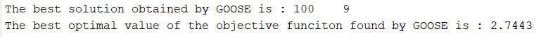
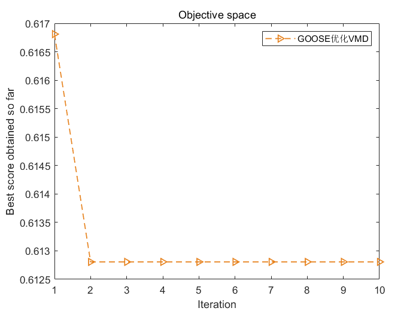
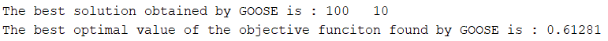
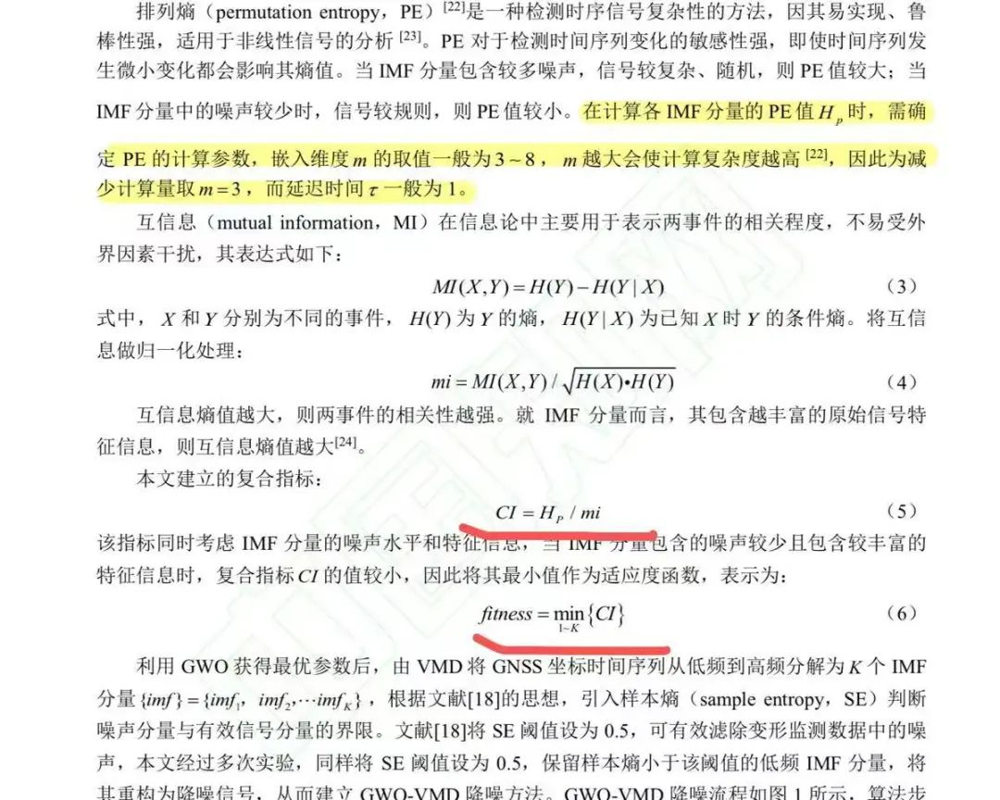
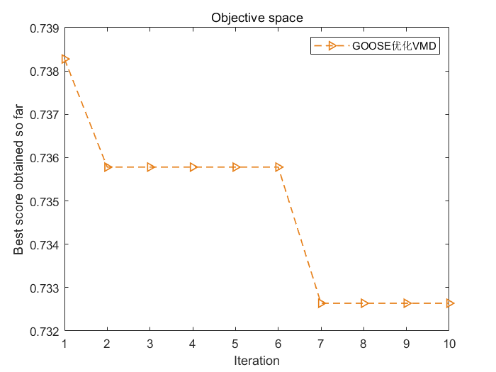
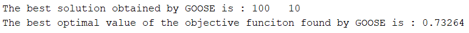

<!-- PAYMENT_BLOCK -->

## Get this dataset

- Payment link (Stripe): [Buy now](https://buy.stripe.com/3cs8yP7sY87d0vu9AB)
- Payment QR code: 

<!-- /PAYMENT_BLOCK -->
